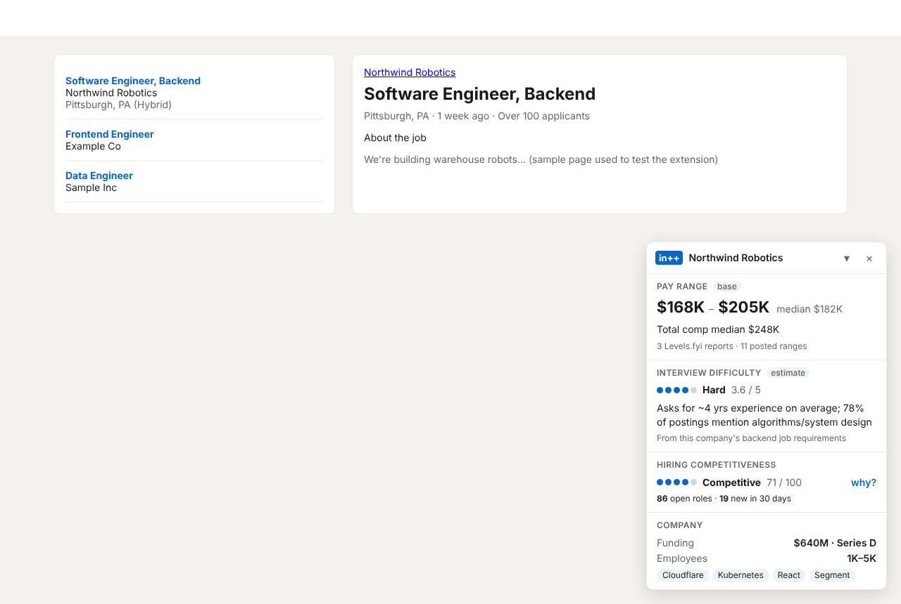

# LinkedIn++

A Chrome extension that overlays **pay ranges**, **interview difficulty** and **hiring competitiveness** on LinkedIn job pages. A Python pipeline builds the numbers from public company data.



*Screenshot: the real extension running in Chrome against the real API, on a sample job page for a fictional company with sample data.*

## How it works

```
 SEC EDGAR ─┐
 Greenhouse ┤                                             ┌──────────── Chrome ────────────┐
 Lever      ├─► pipeline (Python) ─► PostgreSQL ─► API (Node/Express) ◄─ background worker │
 Ashby      ┤    normalize, resolve     (Supabase)    + Redis cache   │        ▲          │
 Crunchbase ┤    entities, score                                      │  content script   │
 BuiltWith  ┤                                                         │  on linkedin.com  │
 Levels.fyi ┘ (file import)                                           │  → overlay (React)│
                                                                      └───────────────────┘
```

1. **Pipeline** (`pipeline/`, Python): pulls each source, resolves every record to one company (by SEC CIK, website domain, or normalized name: "Coinbase" on LinkedIn = "Coinbase Global, Inc." at the SEC), and stores it in Postgres. `lpp compute` then turns it into insights.
2. **API** (`server/`, TypeScript): `GET /api/insights?company=…&title=…` classifies the job title, looks up the company, and picks the most specific numbers that have enough data behind them. Responses are cached in Redis.
3. **Extension** (`extension/`, React + TypeScript, Manifest V3): reads the company and title from the LinkedIn job page, asks the API through its background worker, and renders the card inside a Shadow DOM so LinkedIn's CSS can't touch it. It follows LinkedIn's in-page navigation between jobs.

## Data sources

| Source | What it provides | Access |
|---|---|---|
| **SEC EDGAR** | All ~10,000 US-listed companies; annual revenue, growth and net income from 10-K XBRL data; industry | Free; set `LPP_USER_AGENT` to "your name email" as SEC requires |
| **Career pages** | Open roles and posted salary ranges from Greenhouse, Lever and Ashby job boards (structured pay fields, or the pay-transparency range in the description) | Free public job-board APIs; companies listed in `pipeline/seeds/companies.csv` |
| **Crunchbase** | Funding total, last round, founding date, headcount range | `CRUNCHBASE_API_KEY` |
| **BuiltWith** | Tech stack from the company website | `BUILTWITH_API_KEY` (free API gives categories, paid gives technologies) |
| **Levels.fyi** | Self-reported base and total compensation | **File import only.** Levels.fyi has no public API and its terms prohibit scraping, so `lpp import-levels` loads a CSV/JSON you obtained legitimately |
| **OpenAI** (optional) | Interview-difficulty estimate from job requirements | `OPENAI_API_KEY`; without it a transparent heuristic is used |

## What the numbers mean

- **Pay range**: 25th to 75th percentile of base pay for the job's role family and seniority at that company, pooling posted salary ranges (midpoints) and Levels.fyi base salaries. A range needs at least 3 data points. Otherwise the API steps out to the whole family, then related families (backend ↔ software engineering), and the card says so. The data-point count is always shown.
- **Interview difficulty (1–5)**: an *estimate* from the company's own job requirements: years of experience asked for, how often algorithms/system design/coding assessments come up, degree requirements, seniority mix, and hiring competitiveness. With an OpenAI key, a model reads sample requirement sections and writes the rationale.
- **Hiring competitiveness (0–100)**: public signals ranked against every other company in the database: pay (35%), open roles per 100 employees (25%, fewer = harder), company scale (25%), hiring pace (15%, faster = easier). Click **why?** on the card to see each factor.

All formulas are documented in `pipeline/lpp/insights.py`.

## Running it

**Prerequisites:** Python 3.10+, Node 20+, PostgreSQL (local or Supabase), Redis (optional).

```bash
# 1. Database + pipeline
createdb linkedinpp                                   # or use a Supabase connection string
export DATABASE_URL=postgresql://localhost/linkedinpp
export LPP_USER_AGENT="Your Name you@school.edu"
cd pipeline && python -m venv .venv && .venv/bin/pip install -e .
.venv/bin/lpp all --details 500        # SEC companies + financials for the 500 largest, career pages, compute
.venv/bin/lpp import-levels ~/Downloads/levels.csv     # optional
.venv/bin/lpp stats

# 2. API
cd ../server && npm install && npm run dev            # http://localhost:8787

# 3. Extension
cd ../extension && npm install && npm run build
```

Then open `chrome://extensions`, turn on **Developer mode**, click **Load unpacked**, and choose `extension/dist`. Open any LinkedIn job. To use a deployed API instead of localhost, set its URL on the extension's options page.

Add companies by appending rows to `pipeline/seeds/companies.csv`. The board token is the name in the job-board URL (`boards.greenhouse.io/<token>`, `jobs.lever.co/<token>`, `jobs.ashbyhq.com/<token>`).

## Tests

```bash
cd pipeline  && .venv/bin/python -m pytest      # 74 tests, incl. end-to-end against Postgres
cd server    && npm test                         # 38 tests against Postgres + Redis
cd extension && npm test                         # 16 tests (page parsing, overlay, background worker)
```

`shared/rules.json` (title classification, company-name normalization) is used by both Python and TypeScript, and `shared/test_cases.json` is checked by both test suites so they stay identical. CI runs all three suites with Postgres and Redis services.

Beyond unit tests, the full path was run once by hand: pipeline output → API → built extension loaded in Chrome on a sample LinkedIn page, including switching jobs without a reload.

## Limitations

- Source adapters were built against each provider's documented response format and tested with recorded responses. Run `lpp sync-careers` first to catch job-board tokens that have changed.
- LinkedIn changes its markup. The extension tries several selector generations and falls back to the page title, but a redesign can still break extraction.
- Interview difficulty is inferred from public job requirements, not from interview reports.
- Competitiveness is relative to the companies in your database, so it means more as the database grows.
